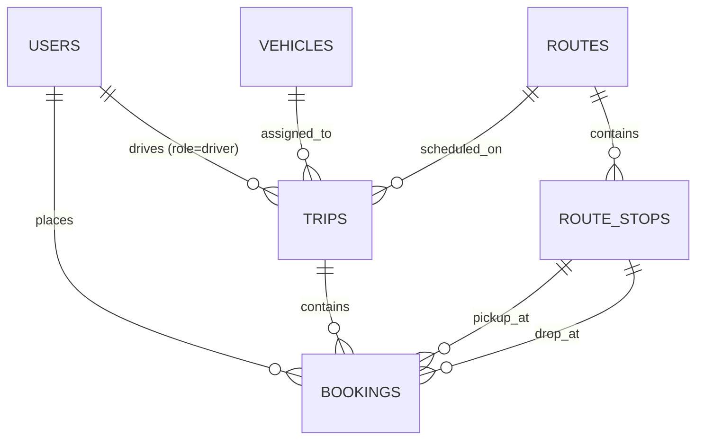

# TransFleet — Smart Transit & Fleet Operations Management System
**Course**: Full Stack Development (FSD) • 5th Semester  
**Workspace**: `tr-mng` (Transportation Management)

---

## 1. Executive Summary & Problem Statement
Traditional transportation and fleet systems are heavily fragmented: administrators struggle with manual dispatching and vehicle maintenance tracking, commuters lack seat certainty, and drivers rely on phone calls for route updates.

**TransFleet** is a modern, full-stack, enterprise-grade Transit & Fleet Management Platform that connects three core stakeholders in a single responsive web interface:
1. **Fleet Administrators**: Monitor real-time fleet health (Active, Maintenance, Idle), track EV transition metrics, create multi-stop transit lines, schedule trips, and evaluate operational KPIs.
2. **Passengers (Commuters / Students)**: Browse live schedules, check real-time seat availability, select exact pickup/drop-off checkpoints, reserve seats with atomic ACID guarantees, and generate digital boarding passes.
3. **Transit Drivers**: Operate an interactive mobile-first dispatch console to advance through sequenced stops (`Departed` ➔ `Next Stop` ➔ `Completed`), broadcasting transit progression and verifying passenger boarding tokens.

---

## 2. Technology Stack Selection (Approved Matrix)

| Segment | Technology | Role & Implementation Details |
| :--- | :--- | :--- |
| **Segment 1: Styling** | **Tailwind CSS (v3)** | Utility-first CSS architecture, mobile-first responsive breakpoints (`sm:`, `md:`, `lg:`), custom dark-mode slate theme, glassmorphic card overlays, and minimal CSS runtime overhead. |
| **Segment 2: Frontend** | **React.js (Vite)** | Modular component architecture, Virtual DOM diffing, React Hooks (`useState`, `useEffect`, `useContext`), unified `AuthContext` state management, and asynchronous REST API integration. |
| **Segment 3: Backend** | **Node.js + Express.js** | Non-blocking asynchronous event loop, RESTful endpoint routing, custom authentication middleware (JWT verification & RBAC authorization), and centralized error handling. |
| **Segment 4: Database** | **MySQL (via XAMPP)** | 3NF normalized relational schema, foreign key constraints (`CASCADE` & `RESTRICT`), connection pooling (`mysql2/promise`), and atomic row-level locking (`FOR UPDATE`) for race-condition prevention. |

---

## 3. System Architecture

```
+-------------------------------------------------------------------------+
|                           CLIENT TIER (React SPA)                       |
|   - Admin Dashboard    - Fleet Assets Manager     - Route Sequencer     |
|   - Passenger Portal   - Digital Boarding Passes  - Driver Console      |
+------------------------------------+------------------------------------+
                                     |
                          REST API (JSON over HTTP)
                          Bearer JWT Token Header
                                     |
+------------------------------------v------------------------------------+
|                         SERVER TIER (Express.js)                        |
|   - Auth Controller & JWT Signer     - Vehicle Fleet CRUD               |
|   - Route & Stops Sequencer          - Trip Scheduler & Status Dispatch |
|   - Atomic Seat Reservation Engine   - Boarding Token Validator         |
+------------------------------------+------------------------------------+
                                     |
                       Connection Pool (mysql2/promise)
                       ACID Transaction Boundary
                                     |
+------------------------------------v------------------------------------+
|                         DATABASE TIER (MySQL 8/MariaDB)                 |
|   - users: (id, name, email, password_hash, role, phone)                |
|   - vehicles: (id, plate_number, model, capacity, status, fuel_type)    |
|   - routes: (id, route_name, origin, destination, distance_km)         |
|   - route_stops: (id, route_id, stop_name, stop_order, minutes_offset)  |
|   - trips: (id, route_id, vehicle_id, driver_id, departure, seats)      |
|   - bookings: (id, trip_id, user_id, pickup_stop, drop_stop, token)     |
+-------------------------------------------------------------------------+
```

---

## 4. Database Schema & Normalization (3NF)



### Normalization Justification:
* **1NF (First Normal Form)**: All column values are atomic. Repeating route stop arrays are decoupled into an independent `route_stops` table with unique stop identifiers.
* **2NF (Second Normal Form)**: All non-key attributes (`fare`, `departure_time`, `status`) depend fully on the primary key `id` rather than composite candidate keys.
* **3NF (Third Normal Form)**: No transitive dependencies exist. For example, vehicle capacity and fuel type remain strictly in `vehicles` and are not duplicated inside `trips` or `bookings`.

---

## 5. Pre-Configured Test Accounts (Viva Demonstration)

The sign-in screen includes one-click **Quick-Fill Demo Credentials** so you can log in as any role without manual typing during evaluation:

| Persona | Role | Email | Password | Dedicated View & Capabilities |
| :--- | :--- | :--- | :--- | :--- |
| **Fleet Administrator** | `admin` | `admin@transfleet.com` | `admin123` | Operations Command Center, Fleet Vehicles, Transit Routes, Trip Schedules, Passenger Manifest, Live MySQL Inspector |
| **Transit Driver** | `driver` | `driver.rajesh@transfleet.com` | `driver123` | Driver Console: Station-to-station Milestone Advance & Passenger Boarding Pass Token Check-in Scanner |
| **Passenger / Rider** | `passenger`| `priya.sharma@gmail.com` | `passenger123` | Passenger Portal: One-way sequential route search, seat reservation, digital token generation, in-app cancellation |

---

## 6. How to Run the Project

### Method A: One-Click Startup (Recommended)
Double-click [`run_project.bat`](file:///e:/documents/5th%20Sem/FSD/tr-mng/run_project.bat) in the project root directory. It will ensure MySQL is running, start the server on port 5000, and launch your browser.

### Method B: Terminal Execution
1. Ensure XAMPP MySQL is running on port 3306.
2. In terminal, navigate to the `server` folder and run:
   ```bash
   cd server
   node server.js
   ```
3. Open your browser and navigate to:
   ```
   http://localhost:5000
   ```

---

## 7. Viva Voce Defense Master Sheet (High-Frequency Questions)

### Q1: "How do you handle race conditions during simultaneous seat bookings?"
> **Answer**: "We handle concurrency using atomic database operations and row-level locking within a MySQL transaction in `bookingController.js`. We execute:
> ```sql
> SELECT id, available_seats, status FROM trips WHERE id = ? FOR UPDATE;
> UPDATE trips SET available_seats = available_seats - 1 WHERE id = ? AND available_seats > 0;
> ```
> The `FOR UPDATE` clause locks the targeted trip row. If two passengers submit a booking request for the last remaining seat at the exact same millisecond, MySQL processes one transaction, decrements the seat count, and causes the second transaction to read `available_seats = 0`, triggering a safe rollback and an HTTP 409 Conflict error without double-booking."

### Q2: "Why choose MySQL over MongoDB for this project?"
> **Answer**: "Transportation data is fundamentally relational. A transit trip depends on an existing vehicle, an assigned driver, and an ordered sequence of designated stops. Using MySQL allows foreign key constraints (`ON DELETE CASCADE`, `ON DELETE RESTRICT`) to enforce referential integrity and prevent orphaned records. In addition, financial and reservation workflows require ACID transaction compliance."

### Q3: "Explain how Authentication and Authorization work in your application."
> **Answer**: "User passwords are salted and hashed using `bcryptjs` before storage. Upon successful login, the server signs a JSON Web Token (JWT) containing the user's `id`, `email`, and `role`. The client includes this token in the `Authorization: Bearer <token>` header of every subsequent HTTP request. The backend uses two Express middleware functions:
> 1. `verifyToken`: Decodes and validates the cryptographic token signature.
> 2. `requireRole('admin')`: Performs Role-Based Access Control (RBAC) to restrict administrative endpoints like vehicle registration."

### Q4: "What is the purpose of React's Virtual DOM in your dashboard?"
> **Answer**: "When transit drivers advance a trip stop or when passengers book a seat, React updates its in-memory Virtual DOM tree, calculates the minimal diff between previous and current virtual representations using its reconciliation algorithm, and selectively updates only the affected DOM nodes instead of re-rendering the full page."

### Q5: "What are the advantages of Tailwind CSS over standard CSS?"
> **Answer**: "Tailwind CSS uses a utility-first methodology. It avoids the maintenance bottleneck of custom CSS classes, ensures a consistent design system (colors, padding, spacing), enforces mobile-first responsive breakpoints (`sm:`, `md:`, `lg:`), and purges unused styles during production build, resulting in a lightweight final stylesheet."
