<div align="center">

# 🚌 TransFleet
### Smart Transit & Fleet Operations Management System

[](https://react.dev/)
[](https://vitejs.dev/)
[](https://nodejs.org/)
[](https://www.mysql.com/)
[](https://tailwindcss.com/)
[](https://jwt.io/)

**Course**: Full Stack Development (FSD) • 5th Semester

*A modern, enterprise-grade platform connecting Fleet Administrators, Passengers, and Transit Drivers in one responsive web application.*

---

</div>

## 📋 Table of Contents

- [Executive Summary](#-executive-summary)
- [Technology Stack](#-technology-stack)
- [System Architecture](#️-system-architecture)
- [Database Schema](#-database-schema)
- [Features by Role](#-features-by-role)
- [Demo Accounts](#-demo-accounts)
- [Getting Started](#-getting-started)
- [Project Structure](#-project-structure)
- [API Endpoints](#-api-endpoints)
- [Key Technical Decisions](#-key-technical-decisions)

---

## 🎯 Executive Summary

Traditional transportation and fleet systems are heavily fragmented — administrators struggle with manual dispatching, commuters lack seat certainty, and drivers rely on phone calls for route updates.

**TransFleet** solves all of this in a single, unified full-stack platform. It connects **three core stakeholders** through a clean, role-aware interface:

| Stakeholder | Role |
|:---|:---|
| 🛡️ **Fleet Administrator** | Monitor real-time fleet health, manage vehicles, create routes, schedule trips, and track KPIs |
| 🎟️ **Passenger / Commuter** | Browse live schedules, check seat availability, reserve seats with ACID guarantees, and get digital boarding passes |
| 🚗 **Transit Driver** | Operate a mobile-first dispatch console, advance through sequenced stops, and verify passenger boarding tokens |

---

## 🛠️ Technology Stack

| Layer | Technology | Rationale |
|:---|:---|:---|
| **Frontend** | React 19 + Vite 8 | Modular component architecture, Virtual DOM, React Hooks (`useState`, `useEffect`, `useContext`), unified `AuthContext` |
| **Styling** | Tailwind CSS v3 | Utility-first, mobile-first breakpoints, custom dark-mode slate theme, glassmorphic card overlays, near-zero runtime CSS |
| **Backend** | Node.js + Express.js | Non-blocking async event loop, RESTful routing, custom JWT middleware, centralized error handling |
| **Database** | MySQL 8 (via XAMPP) | 3NF normalized schema, foreign key constraints, connection pooling (`mysql2/promise`), atomic row-level locking |
| **Auth** | JWT + bcryptjs | Stateless authentication, RBAC (Role-Based Access Control), salted password hashing |
| **Icons** | Lucide React | Consistent, tree-shakeable icon set |

---

## 🏗️ System Architecture

```
┌─────────────────────────────────────────────────────────────────────┐
│                      CLIENT TIER (React SPA)                        │
│                                                                     │
│   🛡️ Admin Dashboard      🗺️ Fleet Assets Manager                  │
│   🎟️ Passenger Portal     🚉 Route Sequencer                        │
│   🎫 Digital Boarding     🚗 Driver Dispatch Console                │
└──────────────────────────────┬──────────────────────────────────────┘
                               │
                    REST API (JSON / HTTP)
                    Authorization: Bearer <JWT>
                               │
┌──────────────────────────────▼──────────────────────────────────────┐
│                     SERVER TIER (Express.js)                        │
│                                                                     │
│   🔐 Auth Controller & JWT Signer     🚌 Vehicle Fleet CRUD        │
│   🗺️ Route & Stops Sequencer          📅 Trip Scheduler            │
│   💺 Atomic Seat Reservation Engine   🎫 Boarding Token Validator   │
└──────────────────────────────┬──────────────────────────────────────┘
                               │
                   Connection Pool (mysql2/promise)
                   ACID Transaction Boundary
                               │
┌──────────────────────────────▼──────────────────────────────────────┐
│                    DATABASE TIER (MySQL 8 / MariaDB)                │
│                                                                     │
│   users         → id, name, email, password_hash, role, phone      │
│   vehicles      → id, plate_number, model, capacity, status        │
│   routes        → id, route_name, origin, destination              │
│   route_stops   → id, route_id, stop_name, stop_order             │
│   trips         → id, route_id, vehicle_id, driver_id, departure  │
│   bookings      → id, trip_id, user_id, pickup_stop, token         │
└─────────────────────────────────────────────────────────────────────┘
```

---

## 🗄️ Database Schema

```mermaid
erDiagram
    USERS ||--o{ BOOKINGS : "places"
    USERS ||--o{ TRIPS : "drives (role=driver)"
    VEHICLES ||--o{ TRIPS : "assigned_to"
    ROUTES ||--o{ ROUTE_STOPS : "contains"
    ROUTES ||--o{ TRIPS : "scheduled_on"
    TRIPS ||--o{ BOOKINGS : "contains"
    ROUTE_STOPS ||--o{ BOOKINGS : "pickup_at"
    ROUTE_STOPS ||--o{ BOOKINGS : "drop_at"

    USERS {
        int id PK
        string name
        string email
        string password_hash
        enum role
        string phone
    }

    VEHICLES {
        int id PK
        string plate_number
        string model
        int capacity
        enum status
        string fuel_type
    }

    ROUTES {
        int id PK
        string route_name
        string origin
        string destination
        float distance_km
    }

    TRIPS {
        int id PK
        int route_id FK
        int vehicle_id FK
        int driver_id FK
        datetime departure_time
        int available_seats
        enum status
    }

    BOOKINGS {
        int id PK
        int trip_id FK
        int user_id FK
        int pickup_stop FK
        int drop_stop FK
        string token
        enum status
    }
```



### Normalization Justification (3NF)

| Normal Form | How it's achieved |
|:---|:---|
| **1NF** | All column values are atomic. Route stops are in a separate `route_stops` table — no arrays in any column |
| **2NF** | All non-key attributes depend fully on the primary key `id`, not on composite candidate keys |
| **3NF** | No transitive dependencies — vehicle capacity lives in `vehicles`, never duplicated in `trips` or `bookings` |

---

## ✨ Features by Role

<details>
<summary><b>🛡️ Fleet Administrator</b></summary>

- **Operations Command Center** — Live KPI dashboard: active trips, fleet health, revenue metrics, EV transition ratio
- **Fleet Vehicle Manager** — Full CRUD for vehicles (plate number, model, capacity, status: Active / Maintenance / Idle, fuel type)
- **Transit Route Builder** — Create multi-stop transit lines with drag-ordered stop sequences and time offsets
- **Trip Scheduler** — Assign vehicle + driver to a route, set departure time, manage seat allocation
- **Passenger Manifest** — View all bookings per trip; validate digital boarding tokens
- **Live MySQL Inspector** — Real-time view of active DB connections and query stats

</details>

<details>
<summary><b>🎟️ Passenger / Commuter</b></summary>

- **Route Search** — One-way sequential route discovery with origin/destination filter
- **Live Seat Availability** — Real-time seat count per trip before booking
- **Stop Selection** — Pick exact pickup and drop-off checkpoints from sequenced stop list
- **Atomic Seat Reservation** — Race-condition-safe booking with `FOR UPDATE` row locking
- **Digital Boarding Pass** — Unique token generated per booking (QR-ready)
- **In-App Cancellation** — Self-service booking cancellation with seat restoration

</details>

<details>
<summary><b>🚗 Transit Driver</b></summary>

- **Dispatch Console** — Mobile-first view of assigned trips for the day
- **Stop Milestone Advance** — Progress tracker: `Scheduled` → `Departed` → `Next Stop` → `Completed`
- **Boarding Token Scanner** — Verify passenger tokens against the manifest for boarding check-in

</details>

---

## 🔑 Demo Accounts

The login screen includes **one-click Quick-Fill** buttons so you can log in as any role instantly during evaluation — no manual typing needed.

| Persona | Role | Email | Password |
|:---|:---|:---|:---|
| 👨‍💼 **Fleet Administrator** | `admin` | `admin@transfleet.com` | `admin123` |
| 🚗 **Transit Driver** | `driver` | `driver.rajesh@transfleet.com` | `driver123` |
| 🧑‍🤝‍🧑 **Passenger** | `passenger` | `priya.sharma@gmail.com` | `passenger123` |

---

## 🚀 Getting Started

### Prerequisites

- **Node.js** v18 or higher
- **XAMPP** (MySQL/MariaDB running on port `3306`)
- **npm** v8+

### Method A: One-Click Startup ⚡

Double-click **`run_project.bat`** in the project root. It will:
1. Check that MySQL is running
2. Start the Express server on port `5000`
3. Launch the Vite dev server and open your browser

### Method B: Manual Setup

**1. Clone the repository**
```bash
git clone https://github.com/alispatel1296/Travelmanagement.git
cd Travelmanagement
```

**2. Set up the database**
- Start XAMPP and ensure MySQL is running on port `3306`
- Create a database named `transfleet` in phpMyAdmin
- Import the schema (if provided) or let the server auto-migrate on first run

**3. Configure environment variables**
```bash
cp server/.env.example server/.env
# Edit server/.env with your MySQL credentials
```

```env
# server/.env
DB_HOST=localhost
DB_PORT=3306
DB_USER=root
DB_PASSWORD=
DB_NAME=transfleet
JWT_SECRET=your_super_secret_key_here
PORT=5000
```

**4. Install dependencies & run**
```bash
# Install backend dependencies
cd server
npm install

# In a new terminal — install frontend dependencies
cd client
npm install

# Start backend (from server/)
npm start

# Start frontend (from client/)
npm run dev
```

**5. Open in browser**
```
Frontend:  http://localhost:5173
Backend:   http://localhost:5000
```

---

## 📁 Project Structure

```
Travelmanagement/
├── client/                     # React + Vite Frontend
│   ├── src/
│   │   ├── components/         # Reusable UI components
│   │   ├── context/            # AuthContext (global state)
│   │   ├── pages/              # Route-level page components
│   │   │   ├── admin/          # Admin dashboard pages
│   │   │   ├── driver/         # Driver console pages
│   │   │   └── passenger/      # Passenger portal pages
│   │   ├── services/           # Axios API service layer
│   │   ├── App.jsx             # Router + layout shell
│   │   └── main.jsx            # React DOM entry point
│   ├── tailwind.config.js
│   └── vite.config.js
│
├── server/                     # Node.js + Express Backend
│   ├── config/                 # DB connection pool setup
│   ├── controllers/            # Business logic handlers
│   │   ├── authController.js
│   │   ├── vehicleController.js
│   │   ├── routeController.js
│   │   ├── tripController.js
│   │   ├── bookingController.js
│   │   └── analyticsController.js
│   ├── middleware/             # JWT verify + RBAC
│   ├── routes/                 # Express route definitions
│   └── server.js               # App entry point
│
├── run_project.bat             # One-click startup script
├── package.json
├── .gitignore
└── README.md
```

---

## 🔌 API Endpoints

<details>
<summary><b>Auth Routes</b> — <code>/api/auth</code></summary>

| Method | Endpoint | Access | Description |
|:---|:---|:---|:---|
| `POST` | `/api/auth/register` | Public | Register a new user |
| `POST` | `/api/auth/login` | Public | Login and receive JWT |
| `GET` | `/api/auth/me` | Protected | Get current user profile |

</details>

<details>
<summary><b>Vehicle Routes</b> — <code>/api/vehicles</code></summary>

| Method | Endpoint | Access | Description |
|:---|:---|:---|:---|
| `GET` | `/api/vehicles` | Admin | List all vehicles |
| `POST` | `/api/vehicles` | Admin | Register a new vehicle |
| `PUT` | `/api/vehicles/:id` | Admin | Update vehicle details |
| `DELETE` | `/api/vehicles/:id` | Admin | Remove a vehicle |

</details>

<details>
<summary><b>Route & Stop Routes</b> — <code>/api/routes</code></summary>

| Method | Endpoint | Access | Description |
|:---|:---|:---|:---|
| `GET` | `/api/routes` | All | List all transit routes |
| `POST` | `/api/routes` | Admin | Create a new route with stops |
| `GET` | `/api/routes/:id/stops` | All | Get ordered stops for a route |

</details>

<details>
<summary><b>Trip Routes</b> — <code>/api/trips</code></summary>

| Method | Endpoint | Access | Description |
|:---|:---|:---|:---|
| `GET` | `/api/trips` | All | List/search available trips |
| `POST` | `/api/trips` | Admin | Schedule a new trip |
| `PATCH` | `/api/trips/:id/status` | Driver | Advance trip stop milestone |

</details>

<details>
<summary><b>Booking Routes</b> — <code>/api/bookings</code></summary>

| Method | Endpoint | Access | Description |
|:---|:---|:---|:---|
| `POST` | `/api/bookings` | Passenger | Reserve a seat (atomic) |
| `GET` | `/api/bookings/my` | Passenger | Get my bookings |
| `DELETE` | `/api/bookings/:id` | Passenger | Cancel a booking |
| `POST` | `/api/bookings/verify` | Driver | Verify boarding token |

</details>

---

## 🧠 Key Technical Decisions

### ⚡ Race Condition Prevention (Concurrent Seat Bookings)

Two passengers booking the last seat simultaneously is handled using **MySQL row-level locking**:

```sql
-- In bookingController.js, wrapped in a transaction:
START TRANSACTION;

SELECT id, available_seats, status
FROM trips
WHERE id = ? FOR UPDATE;          -- Locks the row

UPDATE trips
SET available_seats = available_seats - 1
WHERE id = ? AND available_seats > 0;  -- Atomic decrement

COMMIT;
```

If two requests race, the first acquires the lock, the second waits. Once released, the second reads `available_seats = 0` → safe **HTTP 409 Conflict** rollback. Zero double-bookings guaranteed.

---

### 🔐 Authentication & Authorization (JWT + RBAC)

```
User logs in → bcryptjs verifies hash → Server signs JWT { id, email, role }
                                                              ↓
Every protected request sends: Authorization: Bearer <token>
                                                              ↓
Express Middleware chain:
  verifyToken()       → Decodes JWT, attaches req.user
  requireRole('admin') → Guards admin-only endpoints via RBAC
```

---

### ⚛️ React Virtual DOM & State

When a driver advances a stop or a passenger books a seat, React:
1. Updates its in-memory **Virtual DOM tree**
2. Runs the **reconciliation diffing algorithm**
3. Patches **only affected real DOM nodes** — no full-page re-render

Global auth state is managed through a unified `AuthContext`, avoiding prop-drilling across the component tree.

---

### 🎨 Why Tailwind CSS?

- **Utility-first** — no custom CSS class naming bottleneck
- **Design system enforced** — consistent spacing, colors, and typography tokens
- **Mobile-first breakpoints** — `sm:`, `md:`, `lg:` built in
- **PurgeCSS in production** — final stylesheet is tiny (only used utilities kept)

---

<div align="center">

**Built with ❤️ as a 5th Semester Full Stack Development Project**

*React • Vite • Node.js • Express • MySQL • Tailwind CSS • JWT*

</div>
